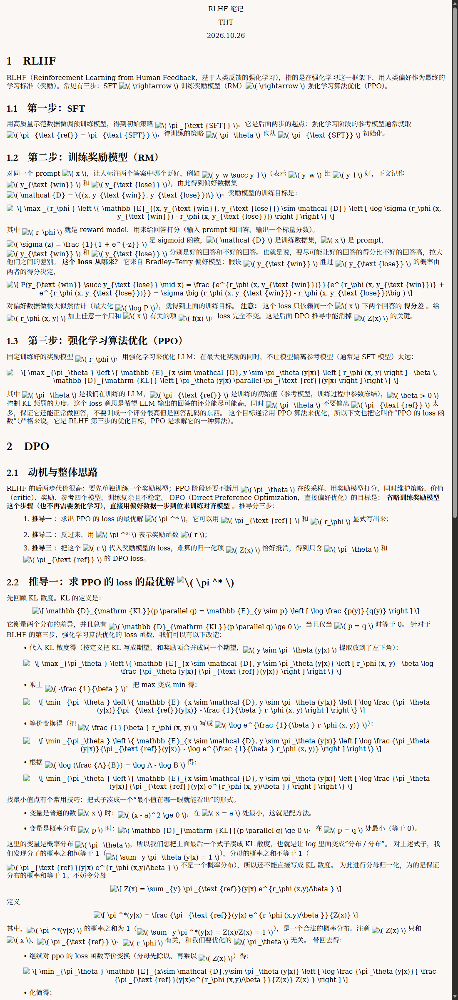

# LaTeX 笔记直接发布到网站：方案调研

> **实施补记**：tex4ht 的公式包裹标签随 TeX Live 版本变化——本地是 `<div class='mathjax-block'>`，
> CI 容器里是 `<span class='mathjax-block'>`，环境型公式是 `<span class='mathjax-env mathjax-align*'>`。
> 转换脚本要同时认这几种写法，否则线上会漏掉公式、把 TeX 源码直接显示出来。
>
> **实施更新（2026-11-22）**：仓库最终采用路线 A（make4ht + LuaLaTeX + KaTeX MathML），源目录为 `latex/<slug>/main.tex`，构建命令见 README。第 0.5 节提到的 Tectonic + Pandoc 原型已经移除，保留这一节是为了记录当时的取舍。
>
> 结论先行：**可行，而且不需要"转换器"**。把 `.tex` 当唯一源文件，在 CI 里用真正的 TeX 引擎编译成 HTML（或 PDF），网站只负责外壳。
> 本文所有数字都是在本机（TeX Live 2025 + Windows）拿**你的真实笔记**跑出来的，不是查文档得来的。

---

## 0. TL;DR

| 路线 | 一句话 | 实测 |
|---|---|---|
| **A. tex4ht / make4ht** | TeX 家自带的 LaTeX→HTML 编译器，必须用 **LuaLaTeX** 才不丢中文 | ✅ DPO 笔记跑通，30 s/篇 |
| **B. lwarp** | LaTeX 宏包，输出语义化 HTML5，定理 / cleveref 支持最好 | ✅ 跑通，15 s/篇，结构最干净 |
| **C. xelatex → PDF + PDF.js** | 不做转换，把 PDF 嵌进页面，100% 保真 | ✅ 10 s/篇，6 页 231 KB |

推荐：**B 或 A 出正文 HTML，C 作为"下载 PDF"**；Hugo 继续当站点外壳（导航 / 标签 / 系列 / RSS / 搜索），内容全部来自 `.tex`。

---

## 0.5 现状：仓库里已经有一版管线（Tectonic + Pandoc）

工作区里有一份未提交的实现，先说清楚它是什么，再说为什么要换：

| 文件 | 作用 |
|---|---|
| `scripts/latex_notes.mjs`（25 KB） | 读 `latex/<lang>/<slug>.tex`，调 **Tectonic** 编 PDF，再调 **Pandoc** 转 HTML；检测到 TikZ / 交叉引用 / beamer 就只走 PDF |
| `latex/zh-cn/*.tex` | 两篇演示源码（一篇纯文本+公式，一篇 TikZ） |
| `content/<lang>/notes/<slug>/index.md` | 脚本生成的页面壳，正文是 Pandoc 产物；同目录还有 `document.pdf` / `plaintext.txt` / `toc.txt` |
| `layouts/partials/latex-pdf.html` | 用 `<iframe>` 嵌 PDF，再附一个"纯文本版本"折叠块 |

**它的问题正好就是你说"不适合"的地方**：

1. **Pandoc 就是那个转换器**。它把 LaTeX 再解析一遍，定理环境、公式编号、交叉引用、自定义宏全部有损；所以脚本才要写 `looksPdfOnly()` 去猜"这篇能不能转"——猜中的就只剩一个 PDF 盒子。
2. **保真和可读互相打架**：保真就走 PDF（不能搜索、移动端要缩放），可读就走 Pandoc（排版走样）。
3. **Tectonic 要在线拉整个 TeX 包**，首次构建慢且需要网络，CI 里不稳。

所以调研的目标很明确：**不要中间的 Markdown/Pandoc 层，继续用 .tex 当源，但要拿到能读、能搜、能自适应的 HTML**。下面的三条路线就是为这个目标比的。


---

## 1. 为什么"不要转换器"是对的

md 管线的根本问题是**源和站不同步**：笔记在 Overleaf 里是 `.tex`，网站上还要维护一份 md，公式、定理编号、交叉引用、定理样式两边各写一遍。任何"tex 转 md"的工具只是把这个不一致外包给了脚本。

编译型管线换了个思路：**.tex 是唯一源，站点是构建产物**。公式交给 TeX 排版，编号交给 TeX 计数，定理样式交给 TeX 宏包，网站只负责把排版结果搬到浏览器。

所以"不要转换器"= 不要 Markdown 中间层，不等于"不能有编译器"。下面是编译器选型。

---

## 2. 候选方案全表

| 项目 | 原理 | 中文 | 数学 | 定理 / 编号 | 依赖 | 本机实测 |
|---|---|---|---|---|---|---|
| **tex4ht / make4ht** | TeX 宏包 + 后处理，官方 TeX Live 组件 | 需 LuaLaTeX | MathML / MathJax / 图片，可配 | 支持，样式要自己接 CSS | 只需 TeX Live | ✅ 跑通，2 个坑见 §4 |
| **lwarp** | 纯 LaTeX 宏包，输出 HTML5 | XeLaTeX 可用 | 默认 SVG，可切 MathJax | **最好**（cleveref / thmtools 有补丁） | TeX Live + `lwarpmk` | ✅ 跑通，多趟构建 |
| **LaTeXML** | Perl 写的 LaTeX→XML→HTML，arXiv 的 ar5iv 用它 | ❌ **没有 CJK 绑定** | MathML，质量高 | 支持 | Perl + CPAN 或 Docker | ⛔ **排除**：仓库 1877 个文件里 `CJK/ctex/xeCJK` 命中 0，issue #2831 仍 open |
| **plasTeX** | Python LaTeX→HTML，可换模板 | 弱 | 一般 | 支持 | Python + 模板 | ⛔ 未实测 |
| **LaTeX.js** | 纯前端 LaTeX 子集编译器 | 弱 | 子集 | 有限 | 浏览器 JS | ⛔ 不支持 ctex / thmtools / cleveref |
| **SwiftLaTeX** | 浏览器内 WASM pdfTeX | pdfTeX 对 ctex 不友好 | 完整 | 完整 | WASM + 字体包 | ⛔ 未实测，产物是 PDF 不是 HTML |
| **xelatex → PDF** | 直接编译 + PDF 嵌入 | ✅ | ✅ | ✅ | TeX Live | ✅ 跑通，10 s/篇 |

> 未实测的四项结论来自文档与公开资料，方案定稿前建议各花 30 分钟验证一遍。

---

## 3. 先把源修好（比选型更关键）

`xelatex -interaction=nonstopmode` 直接编译你 export 的笔记：

| 文件 | 结果 |
|---|---|
| `DPO.tex` | **干净通过**，6 页 PDF，231 KB，10 s（两趟） |
| `强化学习之ppo.tex` | 报 2 处错，nonstop 模式下仍出 7 页 PDF |

ppo 的两处真实错误（Overleaf 上应该也报过，被忽略了）：

1. `l.352`：`\PI` 未定义——多半想写 `\pi` 或 `\Pi`
2. `l.391`：`V_\pi` 写在数学模式外（"但在训练过程中，V_\pi往往无法……"），应写成 `\(V_\pi\)`

**任何管线都编不过有语法错误的源。第一步永远是让 `xelatex` 零错误。**

---

## 4. tex4ht / make4ht（官方组件，实测两个坑）

### 4.1 可用的命令

```bash
# ❌ 不行：XeLaTeX 模式会把中文正文整段丢掉（只剩标题里的中文）
make4ht -x -f html5 -d out ppo.tex "mathml"

# ✅ 可行：LuaLaTeX + mathjax（数学保留为 \( ... \) 交给 KaTeX / MathJax）
make4ht -l -f html5 -d out dpo.tex "mathjax"

# ✅ 也可行：LuaLaTeX + mathml（构建期出 MathML，不需要 JS）
make4ht -l -f html5 -d out dpo.tex "mathml"
```

`"mathml"` / `"mathjax"` 是**跟在文件名后面的参数**，不是 `-f` 的一部分。写成 `-f html5+mathml` 会报 `Cannot load extension: mathml`，然后悄悄退化成图片数学。

⚠️ 更危险的一点：**用 XeLaTeX 或 pdfLaTeX 模式时，中文会整段丢失，但构建仍然"成功"**（错误被吞掉，HTML 照样生成）。所以 CI 里必须强制 `-l`，并且对产物做一次"是否含中文"的断言。

补充两条社区已知问题：ctex + tex4ht 报 `fontspec too old` 时，只编译 HTML 可加 `fontset=none`；make4ht 官方有 Docker Action（github.com/michal-h21/make4ht），CI 里直接用最省事。

### 4.2 实测结果

| 指标 | 值 |
|---|---|
| 构建时间 | 29.7 s（DPO 笔记，LuaLaTeX 一趟） |
| HTML 体积 | MathML 模式 104 KB；mathjax 模式 27.5 KB |
| 中文 | ✅ 完整（3608 个汉字） |
| 数学 | ✅ MathML 150 个 / 或 `\(...\)` 150 个 |
| 标题结构 | ⚠️ **14 处畸形标签** |
| 定理块 | ⚠️ 退化成普通 `<p>`，要用 CSS 重建 |
| 编号 | ✅ 1、1.1、1.2 都在（`<span class="titlemark">`） |

### 4.3 两个必须处理的坑

**坑 1：ctex 让标题产出畸形标签。** 输出是 `<h3class="sectionhead">`（标签名和属性之间少了空格），浏览器当成未知标签，标题样式全废。14 处，一条正则修掉：

```js
html = html.replace(/<([a-zA-Z][a-zA-Z0-9]*?)(class|id|style|display|href|src|alt|title)=/g, "<$1 $2=")
```

**坑 2：MathML 模式下非 ASCII 数学符号会吃掉后面的字符。** 实测 `\ge` / `\le` / `\to` 输出成 `<mo>≥/mo>`（少了 `<`），整段 MathML 从此损坏；而 `>` / `<`（转成 `&gt;`）是正常的。强化学习笔记满是 `\ge`，这个坑很致命。

→ **改用 `mathjax` 模式**：数学保留为 `<span class="mathjax-inline">\(\beta > 0\)`{F}</span>`，然后要么客户端 KaTeX auto-render，要么**构建期**用 `node + katex.renderToString` 换成静态 KaTeX HTML（无 JS，和 Hugo 现有 `transform.ToMath` 产物一致）。

---

## 5. lwarp（结构最干净，实测可跑）

### 5.1 命令与前提

```latex
% lwarp 要放在 preamble 的最前面（不是最后）
\documentclass[UTF8,fontset=fandol]{ctexart}
\usepackage{lwarp}
\input{preamble}
```

```bash
xelatex dpo.tex          # 前两趟生成 lwarp 辅助文件
lwarpmk html dpo         # 生成并切分 HTML
```

前置依赖 `ifptex.sty`（`ptex-base` 包）。本机缺这个包且 tlmgr 无网，我用 5 行 shim 顶上；**CI 里用 `texlive/texlive` 镜像或 `texlive-full` 不存在这个问题**。

### 5.2 实测结果

| 指标 | 值 |
|---|---|
| 构建时间 | 15.3 s（两趟 xelatex + lwarpmk） |
| HTML | 68 KB，**语义化结构**：`<main>`、`<section>`、`<h4 id="autosec-3">`、`<title>RLHF 笔记</title>` |
| 中文 | ✅ 标题与正文都正确 |
| 数学 | 默认 **SVG 图片**（dvisvgm，清晰但不可搜索）；加 `\usepackage[mathjax]{lwarp}` 可切 MathJax |
| 畸形标签 | ✅ 无 |

本机 headless 截图（默认 lwarp CSS）：



> 截图里数学显示成 `\(\pi_{	ext{SFT}}\)` 源码，是 lwarp 在 Windows 上把图片路径写成反斜杠（`src="dpo-lwarp2-images\xx.svg"`）导致 file:// 加载失败。**一条 post-process 把反斜杠换正斜杠即可**，这是 lwarp 在 Windows 的已知小毛病。

### 5.3 lwarp 的优势

- 真 HTML5 语义结构，标题层级与编号正确
- 它自己 patch 了 `hyperref`、`cleveref`、`thmtools`、`booktabs`、`bm`——**正好是你 preamble 用的全套**
- 定理、公式、表格、verbatim、脚注、参考文献都有专门处理
- 自带一套能看的默认 CSS，也能完全换成自己的
- CTAN 上是 0.922，README 自述支持 500+ 宏包、其中 90+ 可与 MathJax 配合；数学默认走 SVG（`` 里带原始 LaTeX，可复制），也可切 MathJax
- 注意：lwarp 的代码在 **CTAN**，GitHub 上只有镜像（bdtc/lwarp，54 star，2024 年后没再推），所以别拿 GitHub 的活跃度判断它

---

## 6. PDF 路线（最稳，当兜底）

```bash
xelatex dpo.tex && xelatex dpo.tex    # 10 s，231 KB / 6 页
```

嵌入方式：
- `<iframe src="/pdf/dpo.pdf">`：零依赖，浏览器自带阅读器，移动端体验一般
- **PDF.js**（Mozilla 开源）：可控阅读器，支持深色模式 / 缩放 / 页内搜索，代价是约 1 MB JS
- 两者都可以再配一个"下载 PDF"按钮

代价：PDF 里的文字**进不了 Pagefind 索引**、不能重排、移动端要缩放、SEO 基本为零。所以 PDF 更适合当**附属**（"这是 Overleaf 原文"），不适合当唯一形态。

---

## 7. 推荐架构：Hugo 当外壳，.tex 当内容

```
tanyrbs.github.io/
├─ content/notes/rl-ppo.md      # 只有 frontmatter，没有正文
├─ notes/rl-ppo/                # 真正的源文件
│  ├─ main.tex                  #  Overleaf 导出的那份
│  ├─ preamble.tex
│  └─ fig/
├─ layouts/                     # 站点外壳（已有）
├─ static/notes/rl-ppo/         # 构建产物（gitignore）
└─ .github/workflows/pages.yml
```

构建流程：

1. **CI 第一步**：起 `texlive/texlive` 容器，对每个 `notes/*/main.tex` 跑 make4ht 或 lwarp
2. **后处理**（约 20 行 Node）：修畸形标签与路径分隔符、注入标题、给容器加 `data-pagefind-body`
3. **Hugo 构建**：模板里用 `{{ os.ReadFile "static/notes/rl-ppo/body.html" | safeHTML }}` 把产物嵌进现有布局，导航 / 侧栏 / 暗色模式 / 评论区全部保留
4. **Pagefind**：产物里有真实文字，自动进索引

结果：**你只在 Overleaf 里写 `.tex`，push 之后网站自动出现一篇排版正确的笔记**，标签 / 系列 / 搜索 / RSS 由 Hugo 提供。

### 元数据放哪
- `\title` / `\date` 已经在 .tex 里，脚本直接读
- tags / series / slug / description 建议写在 `notes/rl-ppo/note.yaml`（三五行），**不动 .tex**，Overleaf 里不受影响

---

## 8. GitHub Actions 落地要点

```yaml
jobs:
  build:
    runs-on: ubuntu-latest
    container: texlive/texlive:latest   # 自带 ctex / fandol / make4ht / lwarp
    steps:
      - uses: actions/checkout@v6
      - name: Compile notes
        run: bash scripts/build-notes.sh
      # 之后照旧：pagefind + hugo
```

- 镜像拉取 1–2 分钟，比 `apt install texlive-full`（3–5 GB）快得多
- 每篇 15–30 s，10 篇 ≈ 3–5 分钟；产物可以加 GitHub Cache
- 容器里默认 root，注意 Hugo 输出目录权限

---

## 9. 决策建议

| 你更在意 | 选 |
|---|---|
| 排版最接近 Overleaf，定理 / 编号 / 交叉引用都要对 | **lwarp** |
| 少折腾、官方组件、能看就行 | **tex4ht + mathjax 模式 + 构建期 KaTeX** |
| 零风险、保真、能随时下载原文 | **xelatex PDF（作为附加）** |
| 学术级语义 HTML、以后想发 arXiv HTML | LaTeXML —— **但中文笔记用不了**，已排除 |

**建议**：**lwarp 首选，tex4ht + mathjax 备选**；两者都产出 HTML 片段交给 Hugo 外壳；PDF 同时产出做"原文下载"。

排除 LaTeXML 的理由是硬的：它文件里没有任何 CJK 绑定（`CJK.sty.ltxml` / `ctex.sty.ltxml` 都不存在），amsthm/thmtools/cleveref 倒是齐全。中文 ctex 笔记走它会在第一行就 `Undefined control sequence`。

---

## 10. 还没验证、需要你确认的点

1. ~~LaTeXML 的中文质量~~——已核实它**没有 CJK 绑定**，直接用不了，不必再验证。
2. **TikZ / 图片**：你的笔记目前没图；以后加图，tex4ht 需要 `dvisvgm`，lwarp 原生支持。
3. **公式编号与交叉引用**：`\cref` 目前只在 `templete1/强化学习1/main.tex` 示例里出现；正式笔记若要用，lwarp 支持明显更好。
4. **构建时间**：20+ 篇笔记会到 10 分钟量级，需要增量构建（只重编改过的 .tex）。

---

## 附录：本次实测的完整命令

```bash
# 1. PDF 基线（先确认源能编）
xelatex -interaction=nonstopmode dpo.tex

# 2. tex4ht（LuaLaTeX 必须）
make4ht -l -f html5 -d out-tex4ht dpo.tex "mathjax"

# 3. lwarp（\usepackage{lwarp} 放在 documentclass 之后、preamble 之前）
xelatex dpo.tex && xelatex dpo.tex && lwarpmk html dpo
```

环境：Windows + TeX Live 2025（完整版）；样本：中文数学写作模板示例.zip 里的 `templete1/强化学习1.1/DPO.tex`。